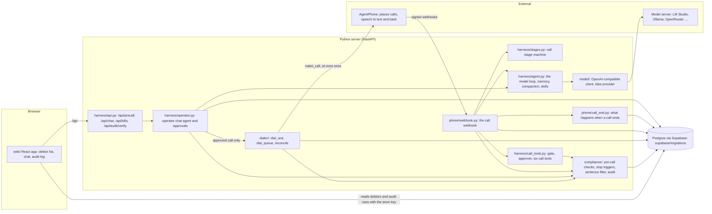
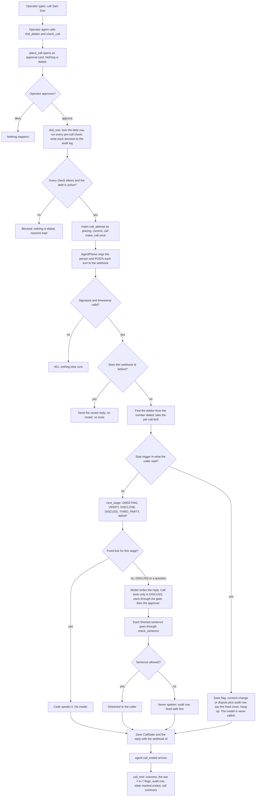
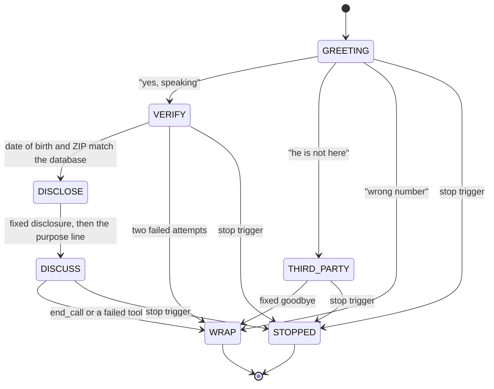

# Architecture

DebtAgentCall is a collection agent that phones people about unpaid accounts, built so that the model talks and the code decides. A person at a text box (the operator) asks for a call; plain Python checks decide whether the call may be placed; AgentPhone does the speech-to-text and text-to-speech; and on every turn of the call, code, not the model, decides what stage the call is in, whether a sentence may be spoken, and whether a tool may run. The model writes the words in the one stage where it is allowed to talk, and every sentence it writes is checked before the caller hears it. Everything is stored in Postgres (a local Supabase), and every compliance decision is written to an append-only, hash-chained audit log. All data in the repository is made up.

This page describes what the code does today. For the rule-by-rule list and the limits of each rule, see [compliance.md](compliance.md). Nothing here is legal advice.

## Components

| Folder | What it holds |
| --- | --- |
| `compliance/` | The rules as plain functions. `precall.py` (`check_before_call`), `hours.py`, `attempts.py`, `consent.py`, `flags.py`, `testnumbers.py`, `timezones.py` (pre-call); `triggers.py` (stop phrases); `utterance.py` (the sentence filter); `audit.py` (the hash-chained log). No model is called here, and nothing reads the model's words except the sentence filter and the stop triggers, which read text with regexes. |
| `harness/` | Everything that runs an agent. `agent.py` (the model loop), `memory.py` (saved history), `compact.py`, `skills.py`, `call_state.py` and `stages.py` (the call's required order), `call_tools.py` (the call tools, the gate and the approver), `call_summary.py`, `operator.py` and `operator_reads.py` (the operator chat), `payments.py`, `bills.py`, `db.py` (all SQL for loading facts), `api.py` (the HTTP API for the web app), `subagents.py` and `review.py` (after-call review only). |
| `phone/` | The AgentPhone side. `webhook.py` (the endpoint and the turn), `signing.py` (HMAC check), `replies.py` (the reply format, streamed), `live_tools.py` (builds one turn's call tools), `call_end.py` (call-ended handling), `client.py` (the outbound `make_call` client and its errors). |
| `dialer/` | `service.py` (`dial_one`, `dial_queue`, `plan_queue`), `cli.py` (`uv run dialer`), `reconcile.py` (`uv run reconcile`). The only code that asks AgentPhone to place a call. No model. |
| `model/` | `chat()` and `chat_stream()` over any OpenAI-compatible endpoint (`openai_compatible.py`), `provider.py` (settings from `.env`), and `fake.py` (a scripted model for tests and demos). |
| `sim/` | A fake AgentPhone: `agentphone_sim.py` plays a scripted caller (YAML in `sim/scripts/`) against the webhook, with real signatures. |
| `supabase/migrations/` | The schema, one file per feature. Next to it, `supabase/local_dev.sql` (loaded on a local start: read access for the web app, no people) and `supabase/demo_seed.sql` (nine made-up debtors and call history that trip one check each, loaded only by `uv run seed-demo`). |
| `web/` | The React app: debtor list with "Ready to call" or "Can't call", the operator chat with approval cards, the audit log with a chain check. It never decides anything itself: badges come from `/api/precall`. |
| `tasks/` | The `uv run` commands: `verify`, `demo`, `accept`, `serve`, `audit-verify`. `checks.py` holds the demos and acceptance checks. |
| `instructions/`, `skills/` | The model's prompts (system, one per stage, operator, subagent) and five short playbooks (hardship, angry caller, and so on). Plain Markdown, re-read every turn. |

## How a call goes, end to end

### 1. The operator chat

The web app posts to `POST /api/chat` (`harness/api.py`). The `Operator` in `harness/operator.py` is an `Agent` with its own prompt (`instructions/operator.md`) and its own tools: finding people, checking a call, reading accounts, and proposing writes. The tools that change anything (`place_call`, `record_payment`, `reverse_payment`, `add_note`, `schedule_callback`) do not write. They record a pending approval that shows the exact person, amount or date. Only `Operator.decide`, reached by `POST /api/chat/approve` and never by the model, dials or writes, and it runs every check again first. `record_stop` is the one write that needs no approval, because a stop can only mean fewer calls. No tool removes a stop, records consent, edits a balance or deletes anything.

### 2. Pre-call checks and the dialer

`dialer.service.dial_one` is the only code that calls `make_call`. In one transaction it locks the debt row (`select ... for update`), loads the facts (`harness/db.py: load_call_facts`), runs `compliance.check_before_call`, and writes every decision, allowed or blocked, to the audit log (`harness/precall.py: check_and_record`). It also requires the debt's status to be `active` (`check_debt_status`, rule id `debt_status`). If anything blocks, nothing is dialed. If everything allows, it inserts a `call_attempt` row with outcome `placing` and commits, then calls `make_call` exactly once. A refusal from AgentPhone becomes an outcome such as `throttled` or `no_funds`; a timeout becomes `placed_unknown`, and the code never retries by itself. The row lock is why two runners cannot both see "6 calls" and both place the 8th. `dial_queue` runs `dial_one` over many debts in a fixed order and stops early on errors that would hit every call. `plan_queue` and `uv run dialer --dry-run` run the same checks and write nothing.

The pre-call rules are listed in [compliance.md](compliance.md). Missing data blocks: no phone, no call history, or no flags loaded each becomes a blocked decision, never a silent pass.

### 3. The webhook: signature, dedupe, stop triggers

AgentPhone POSTs every caller turn to `/webhooks/agentphone` (`phone/webhook.py`). In order:

1. **Signature.** `phone.signing.verify` checks an HMAC-SHA256 over `"{timestamp}.{raw_body}"` against `AGENTPHONE_WEBHOOK_SECRET`, on the raw bytes, and refuses a timestamp more than five minutes from now. A missing secret refuses everything (fail closed). Failures return 401 before any JSON is parsed.
2. **Dedupe.** If the `X-Webhook-ID` was answered before, the same reply is sent back with no model call. Recent ids are kept in memory; on a staged call the id and its reply are also saved with the call state, so a retry after a restart gets the saved reply. A retry of a turn that saved a tool row and then died before replying is not run again: fixed line, hang up, error logged.
3. **Stop triggers, before the model.** `compliance.triggers.detect` runs on what the caller said. If "stop calling", a dispute, a recording objection or a wrong number is found, the webhook saves the flag (and, for "stop calling", sets `phone.revoked_at`; for a verified dispute, marks the debt `disputed`) and one audit row in one transaction, moves the call to `STOPPED`, speaks the trigger's fixed close and hangs up. If the save fails, the close and hang-up still happen and an error is logged: the call never continues because a write failed.

Turns of the same call take a per-call lock, so two webhooks cannot read the same state.

### 4. The call stage machine

`harness/stages.py: next_stage` is a pure function from (state, what the caller said, the debtor) to (new state, a fixed line or "let the model answer").

Code speaks the greeting, the identity questions, the disclosure (recording notice, "automated assistant", the debt collector statement) and the purpose line (creditor and balance read again from the debt's row, never from the model). Date of birth and ZIP are compared in code, including spoken forms (`harness/spoken.py`). The model answers only in `DISCUSS`, or when a caller asks a question in `GREETING`, `VERIFY` or `THIRD_PARTY`. In those early stages the model gets no tools and no skills.

### 5. The call tools: gate, then approver

On a `DISCUSS` turn the model gets six tools from `harness/call_tools.py`: `lookup_account`, `offer_payment_plan`, `schedule_callback`, `log_dispute`, `escalate_to_human`, `end_call`. `phone/live_tools.py` builds them from the saved state, so only the server can say who is verified. There is no `delegate`, `fan_out` or lookup by name.

Every tool call goes through two audited steps:

1. **The gate** (`CallTools.gate`, rule id `call_tool_gate`): the stage must be `DISCUSS` or `WRAP` and the person verified and disclosed (except `log_dispute`, `escalate_to_human` and `end_call`, which are always allowed); a dispute on the debt or on this call blocks offers and callbacks; a `cease` flag blocks them; and a callback must fall within the next 30 days and inside calling hours in every zone the debtor may be in.
2. **The approver** (`PolicyApprover`, rule id `call_tool_approver`): arguments it cannot parse are denied; a payment plan is approved only inside the plan policy (default: at least 10 percent down, at most 12 months, at most 52 installments; overridable per creditor through the `plan_policy` table). A plan outside the policy is saved as `pending` and the caller is told a specialist will confirm it. Nothing is agreed.

Rows a tool saves are committed before the model hears the result. If a save, an audit write or the database fails, the model's reply is not spoken: a fixed line, then hang up.

### 6. The sentence filter

The webhook cuts the model's output into sentences as it streams and checks each complete one with `compliance.check_sentence` (`compliance/utterance.py`) against the call state as it is at that moment, plus `check_commitment` (`phone/live_tools.py`), which drops a sentence that says something was "approved" or "booked" unless code saved it this turn. A sentence that passes goes out at once as an `interim` line, so the caller hears the first one while the model is still writing. The first blocked sentence is never sent: it is written to the audit log (`kind="utterance_blocked"`), the model is stopped, and the turn ends with a fixed safe line. If no line is ready within 2.5 seconds, the fixed line "One moment while I check that." is sent first. The saved history keeps what was really said, so the model does not build on a sentence the caller never heard.

### 7. State saved per turn

After every turn the webhook saves the `CallState` (stage, verified, disclosed, failed verify attempts, whether the date of birth and ZIP matched so far, turn count, ended) as a `state` record in the call's own session, next to its messages, together with the webhook id and the reply. The newest record wins. Compliance never reads facts back out of the messages: whether the person is verified, whether the disclosure was said and whether they asked us to stop live in code (`CallState`, the `flags` table), so a compacted or garbled history cannot change them.

### 8. When the call ends

`agent.call_ended` is sent once and never retried. `phone/call_end.py: record_call_end` finds the `call_attempt` by AgentPhone's call id (locked), derives the outcome from the saved state and the caller's turns (`derive`), and in one transaction updates the attempt (outcome, `connected`, `conversation_with_debtor`, `ended_at`) and writes an audit row. A conversation with the debtor is recorded only with positive evidence: the caller spoke and the state says the person was verified. Anything unexplained becomes `ended_unknown`, counted as no conversation and written to the audit log as a block for a person to look at. Then it marks the state ended and stores a call summary (`harness/call_summary.py`): facts built by code from the state and the rows the call's tools saved, plus an optional one-paragraph narrative a model writes from the facts only, kept only if `check_narrative` passes. A failure in the summary is logged, never raised. The webhook always answers `{}`; `uv run reconcile` finds attempts whose end event never arrived.

## Data model

Tables are in `supabase/migrations/`. Row level security is on for every table; the server connects as the database owner, and the web app reads with the anon key only from the five tables `supabase/local_dev.sql` opens up for local development (`debtor`, `phone`, `debt`, `audit_event` and `payment`, which the balance function reads).

| Table | Holds | Written by |
| --- | --- | --- |
| `debtor`, `phone`, `debt` | The person, each number with its consent record (`consent_at`, `revoked_at`, `line_type`), and the debt (`creditor`, `balance_cents` as placed, `status`: active, disputed, paused or closed). | Seed; `harness/bills.py` on confirm. `phone.revoked_at` and `debt.status` also change from stop triggers, `log_dispute` and the operator's `record_stop` (`harness/db.py`, `harness/call_tools.py`). |
| `call_attempt` | One row per call placed, answered or not: outcome, `connected`, `conversation_with_debtor`, `ended_at`, `end_source`, AgentPhone call id. The 7-in-7 rule counts these. | `dialer/service.py` (insert, then `placed` and refusals); `phone/call_end.py` (the end). |
| `flags` | Facts that stop calls: `cease`, `opt_out_phone`, `dnc`. The table also allows older kinds, which the code no longer reads or writes. | Stop triggers on a live call; the operator's `record_stop`; the seed. Nothing removes a flag. |
| `audit_event` | Every compliance decision. Append-only and hash-chained (below). | `compliance/audit.py: record`, called by the dialer, the webhook, the call tools, the operator, bills and call end. |
| `call_message` | A call's saved history and state, one row per record (`session`, `message`, `compaction`, `state`). The operator chat's history too, under `chat:<id>`. | `harness/memory.py` (`PostgresSession`). |
| `payment_plan`, `callback`, `dispute`, `escalation` | What the call tools save. A plan is `approved` or `pending`. A dispute from an unverified caller is kept with `verified = false` for a person to review. | `harness/call_tools.py`; the operator's `schedule_callback` also writes `callback` (`harness/operator_reads.py`); stop triggers write `dispute` (`harness/db.py`). |
| `plan_policy` | What a plan needs to be approved without a person. | Read by `load_plan_policy`; nothing in the code writes it. |
| `payment` | The money-received ledger. Append-only; a correction is a reversing row. The balance owed now is the SQL function `public.current_balance_cents(debt)`, which every spoken or shown balance goes through. | `harness/payments.py`, only after the operator approves. |
| `debt_note` | Operator notes on a debt. Append-only. | `harness/operator_reads.py`, only after the operator approves. |
| `bill_draft` | A bill as the model read it, with flagged fields, until a person confirms. | `harness/bills.py`. |
| `call_summary` | One row per finished call: `facts` (code), `narrative` (checked model text or null). | `harness/call_summary.py`, from call end. |

### The append-only tables

`audit_event`, `payment` and `debt_note` refuse every `update`, `delete` and `truncate` through triggers, and those privileges are revoked from every role, including the app's own login. A correction is a new row. A debt that has payments or notes cannot be deleted (triggers `debt_keep_if_paid`, `debt_keep_if_noted`).

`audit_event` is also a hash chain. A `before insert` trigger takes a lock, picks the next `seq`, stamps `ts`, and stores `prev_hash` and `hash = sha256(prev_hash || canonical row)`. `compliance/audit.py: verify_chain` recomputes every hash in Python (`uv run audit-verify`, `GET /api/audit/verify`) and reports a gap in `seq`, a broken link, or a row whose contents no longer match its hash. Limit: there is no secret key, so someone who edits a row and recomputes every later hash, or cuts rows off the end, leaves a chain that still verifies. Catching that needs a copy of the newest `seq` and hash kept outside the database, which does not exist yet.

## Memory kinds

The code uses the word "episodic" once, in a migration comment. The other labels group what the code stores, so a reader can find each kind.

| Kind | What it is here | Where it is stored |
| --- | --- | --- |
| Working | The current call: messages, tool results, the stage state, and the compaction summary when a long call nears the context limit. | `call_message` rows through `PostgresSession` (`harness/memory.py`); compaction in `harness/compact.py`. Tests and demos use `JsonlSession` files instead. |
| Episodic | How earlier calls about this debt went. Up to three summaries, newest first, added to the stage context only once the person is verified. | `call_summary` (`harness/call_summary.py`: `context_block`). |
| Semantic | Facts about the account: who, which number, the balance owed now, flags, call history, payments. This is what the call tools and the filter's known amounts read. | `debtor`, `phone`, `debt`, `payment`, `flags`, `call_attempt`, read through `harness/db.py`. |
| Soft | Free text that informs and never decides a rule: operator notes, the model-written narrative in a call summary, and the compaction summary. | `debt_note`, `call_summary.narrative`, `compaction` rows in `call_message`. |
| Knowledge | Instructions and playbooks, not tied to any person. | Files: `instructions/system.md`, `instructions/stages/*.md`, `instructions/operator.md`, `skills/*/SKILL.md`. Re-read on every turn, so an edit applies to the next one. |

The rule across all of them: a fact a rule depends on (verified, disclosed, stop requested, balance) is never read out of memory the model could have garbled. It comes from `CallState`, the flags tables, or the debt's row.

## Where the model is, and where it is not

| Step | Decided by |
| --- | --- |
| Whether a call may be placed | Code (`check_before_call`, `check_debt_status`) |
| Whether the operator's chat may dial | The person's approval, then the same code again |
| Webhook authenticity and repeats | Code (`phone/signing.py`, the seen-ids store) |
| Whether the call must end now | Code (`compliance/triggers.py`) |
| Stage, identity check, disclosure, purpose line | Code (`harness/stages.py`) |
| The wording of a reply in `DISCUSS` | The model, then checked sentence by sentence by code |
| Whether a tool runs, whether a plan is approved | Code (gate, approver) |
| Call outcome and the 7-in-7 inputs | Code (`phone/call_end.py: derive`) |
| After-call review (disclosure, threats, amounts, third party) | Reviewer subagents (`harness/review.py`), which only flag for a person to look at |

## Known gaps

These are things a reader might assume exist and do not. More detail, with each rule's limits, is in [compliance.md](compliance.md).

- The prompts in `instructions/` and `skills/` are guidance only. The rules hold with or without them, and nothing in this document depends on the model following them.
- Nothing yet copies the audit log's newest hash somewhere outside the database.
- Time zones come from a small hand-made table (a handful of ZIP prefixes and area codes). An unknown ZIP and area code blocks the call, which is safe but means most real numbers would be blocked until the table is replaced with a full data source.
- The bill upload exists as an API (`/api/bills`); the web app has no screen for it yet.
- One server process is assumed for the per-call lock and the in-memory seen-ids store.
