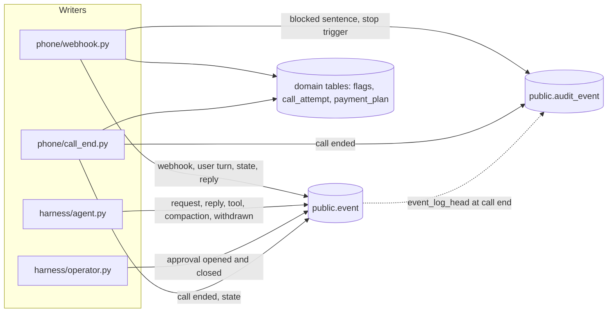
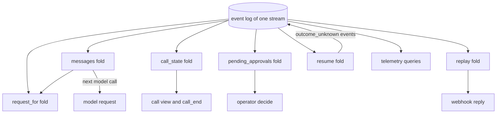

# Design: an append-only event log as the source of truth

Status: proposal, for the owner to decide. No code changes come with this page.

All names, amounts and ids in the examples are made up. Everything said about the current code was checked against the files named next to it, at the commit this page was written on. Names the page proposes (the `event` table, `harness/events.py`, `uv run backfill-events` and the event types) are marked as new or proposed; they do not exist yet. The idea comes from a description of an agent harness that the owner studied. This page takes that description as an idea to test, and makes no claim about how that harness works inside.

## Summary

The idea: one append-only log per call (and per operator chat) holds everything that happened. The message list, the request sent to the model, the call state, pending approvals, the reply to a repeated webhook, resume after a crash, forking, and token counts are all computed from that log by pure functions ("folds").

What the code review found, in short:

- The current store is already nearly append-only. `replace()` does not overwrite rows; it appends a `compaction` row that holds the new full history. So "replace destroys evidence" is overstated for the stored rows. What is true is that the rows do not say what was withdrawn or why, nothing in the database stops an update or delete, and the model's actual request is never stored.
- Approvals are read back out of the chat history (`harness/operator.py`), and the chat history is compacted by the default `Agent`. So an approval opened early in a long chat can drop out of the pending list. This is true, with limits (see 1.4), and it fails closed.
- "Re-reads and re-saves everything" is half true. Every read loads every row of the call; saves are single-row appends except when history is replaced.

Recommendation, argued in section 8: do not do the whole migration now. Finish tool outcomes, fix the approval problem on its own, and keep this design for when the codebase has a second reason to want it (real call volume, several servers, or a need to prove what the model saw).

## 1. The problem, with evidence

### 1.1 Where state lives today

| What | Where it lives | Written by | Read by |
| --- | --- | --- | --- |
| Messages of a call or chat | `public.call_message` rows, `kind = 'message'`, one per message | `Session.append` ([memory.py:60-62](../../harness/memory.py)), via `Agent._add` ([agent.py:123-127](../../harness/agent.py)) | `Session.load` (memory.py:83-92), the live call view |
| Compaction and undo | `call_message` rows, `kind = 'compaction'`, body is the whole new list | `Session.replace` (memory.py:64-66) | `Session.load`, which swaps in the list |
| `CallState` | `call_message` rows, `kind = 'state'`, newest wins | `Session.put_state` (memory.py:68-70), from `_save` ([webhook.py:614-619](../../phone/webhook.py)) and `mark_state_ended` ([call_end.py:198-206](../../phone/call_end.py)) | `Session.last_state` (memory.py:72-75) |
| Replay answer for a repeated webhook | Inside the newest state row, under the key `webhook` (`REPLAY_KEY`, webhook.py:151) | `_save` | `_earlier_reply` (webhook.py:588-611) |
| Replay, second layer | In-process `_SeenIds`, 10,000 ids (webhook.py:238-254) | `create_app` and `_Live.respond` | the route in `create_app` |
| Turn serialization | 64 in-process locks, picked by call id (webhook.py:169) | `_staged_reply`, `_call_ended` | same |
| Operator approvals | Not stored. Recomputed from the message list by `pending_approvals` ([operator.py:202-233](../../harness/operator.py)); closed by a message starting `[approval apr_...]` (operator.py:120) | `Operator.place_call` and the other approval-opening tools; `Operator.decide` (operator.py:948) | `Operator.pending` (operator.py:935), `decide` |
| Flags, consent, disputes, payment plans, attempts | Their own tables (`flags`, `call_attempt`, `payment_plan`, ...) | tools, `record_stop_in_db`, `record_call_end` | the dialer, the call view |
| Compliance decisions | `public.audit_event`, a hash chain | `compliance/audit.py` | `uv run audit-verify`, the call view |
| Call summary | `public.call_summary`, one row per call | `harness/call_summary.py` | the next call about the same debt |
| What the model saw | Nowhere. The payload is rebuilt on each call by `Agent._payload` ([agent.py:148-161](../../harness/agent.py)) | n/a | n/a |

Messages and `CallState` already share one table and one sequence (`seq bigserial`), so the owner's worry about "several places" is more about the three groups below: the message list, the domain rows and the audit log, and the approvals that live only inside the message list.

### 1.2 Where information is destroyed or can drift

1. **`replace()` after compaction.** `Agent.compact` ([agent.py:313-331](../../harness/agent.py)) builds a shorter list with `compact_messages` ([compact.py:129-145](../../harness/compact.py)) and saves it with `session.replace`. The stored effect is one `compaction` row with the whole new list. The old `message` rows stay. `load()` replays them and then lets the compaction row win (memory.py:90-91). So the originals are kept, but they are indistinguishable from messages that are still in play unless you diff lists. Nothing records which span the summary covers, or which summarizer call produced it.
2. **`replace()` after an undo.** `Agent._undo_to` ([agent.py:129-136](../../harness/agent.py)) deletes from the in-memory list and calls `session.replace(self.messages)`. Same shape: the withdrawn turn's rows stay, a full-list row follows, and nothing says "these were withdrawn because the model call failed". The in-memory `_measured` token count is also dropped (agent.py:134) and never stored.
3. **Two more `replace()` callers rewrite what was said.** `_model_turn` replaces the last assistant message with what the caller really heard when a sentence was blocked (webhook.py:790-795), `_tools_failed` replaces it with the fixed line (webhook.py:849-852), and `_send_stream` drops tool requests when the caller hangs up mid-reply (agent.py:241-247). The model's own text survives only as an earlier row.
4. **Approvals recomputed from chat history.** See 1.4.
5. **State records mixed with messages.** `last_state()` and `header()` and `load()` each call `_records()`, which reads every row of the call (memory.py:72-92, 190-196). `last_state` filters the list in Python. The live view needs a correlated subquery per call to find the newest state (call_view.py, `LIST_SQL`).
6. **The replay store.** The reply to the last webhook is a field inside the newest state row. It covers only the newest turn. A retry of an older webhook is not recognised by the durable layer (it relies on `_SeenIds`, which is per process and capped at 10,000). `mark_state_ended` copies the old `webhook` entry forward (call_end.py:204-206), which is correct today but shows how a state row doubles as a dedupe record. The code comment says as much about the process limit: "This only covers one server process" (webhook.py:166-168).
7. **`last_state()` re-reads everything.** `PostgresSession.for_call` calls `_start`, which calls `_records()`, which loads every row (memory.py:94-98, 172-179). One staged turn does `for_call` plus `last_state` in `_earlier_reply`, `for_call` plus `load_state` in `_locked_turn`, and `load` when the `Agent` is built (agent.py:119): about five full reads of the call per turn. `call_end` reads again via `read_state` and `mark_state_ended`, each opening a session.
8. **The call view reads messages, not what happened.** `MESSAGES_SQL` ([call_view.py:181-185](../../harness/call_view.py)) takes the newest 500 `kind = 'message'` rows and `transcript()` ([call_view.py:103-141](../../harness/call_view.py)) turns each into a line. It ignores `compaction` rows. So the live view shows a turn that was later undone, and it shows the text the model wrote for a sentence that was blocked, not the line the caller heard (the corrected text is only in the later full-list row). It is a real drift: the screen can say something that is not in the history the model sees.
9. **Nothing stops an edit.** The `call_message` migration says "Rows are only ever added", but unlike `audit_event` it has no trigger and no revoke ([20261112120000_call_message.sql](../../supabase/migrations/20261112120000_call_message.sql)). Append-only is a convention there.
10. **The model's request is never kept.** `_payload` re-reads `instructions/system.md`, the stage file, the skills folder and `extra_context` (earlier call summaries) on every call, and the module docstring says they are "never stored in `self.messages`" (agent.py:8-13). `_record` keeps only the reply's content and tool calls (agent.py:190-200); usage, finish reason and the exact tool schemas are dropped.

### 1.3 What we cannot answer today

"What exactly did the model see when it said X?" The messages are in `call_message`, but the system prompt, stage prompt, skills menu, tool schemas and earlier-call summaries are whatever the files and tables held at the time, and a later edit to `instructions/stages/discuss.md` silently changes the answer. This part of the owner's claim is true.

### 1.4 Can approvals be lost to compaction?

Verdict: **true in part, and it fails closed.**

What the code does. `Operator.pending` is `pending_approvals(self.agent.messages)` (operator.py:935-936). That function scans the current message list for `tool` messages whose JSON has `status == needs_approval`, minus those closed by a later message starting `[approval ...]`. `Operator.__init__` builds a plain `Agent` with its default settings (operator.py, `self.agent = Agent(...)`; no `max_context_tokens`, `keep_head` or `keep_tail` is passed, and `harness/operator.py` and `harness/api.py` never mention compaction). The default `Agent` runs `_maybe_compact` before each user turn (agent.py:305-311) once the estimated next call passes 80 percent of 16,000 tokens. `compact_messages` keeps the first 2 and last 6 messages and replaces the middle with a prose summary (compact.py:88-107, 129-145).

So an approval is lost when both hold: the chat grew past the line, and the `needs_approval` tool message sits in the summarised middle. Then `pending()` no longer lists it and `decide` raises `LookupError("no pending approval ...")` (operator.py:948 onward). The summary text may mention it, but nothing machine-readable survives.

What it does not do: it never approves, dials or writes by mistake. A lost approval just cannot be approved; the operator would ask again. The closing marker is always later than the opening message, so a surviving opening message always keeps its marker: a closed approval cannot come back to life. No test covers a compaction in the operator chat (`tests/harness/test_operator_chat.py` has none; compaction tests are in `tests/harness/test_compaction.py` and use the call agent). It needs a long operator chat to occur, so it is not likely in a demo, which is why "partly true" is the fair word.

Relatedly, an approval opened in a turn that then fails is removed by `_undo_to`, so it also vanishes from `pending()`. Today that is wanted behaviour (the operator never saw a reply), but it is the same mechanism.

### 1.5 The owner's claims, checked

| Claim | Verdict |
| --- | --- |
| `replace()` overwrites history; undo throws it away | Overstated. Rows are appended, not overwritten; the originals stay. The live list is replaced, and the stored form does not say what was withdrawn or why. |
| Approvals can be lost to compaction | True for the operator chat, with the limits in 1.4. |
| The store re-reads and re-saves everything | Reads: true (about five full reads per staged turn). Saves: false in general, since `append` writes one row; only `replace()` writes the whole list (compaction, undo, a blocked sentence, a failed tool). |
| The store is slow | Not shown. A call has tens to a few hundred rows. Nothing in the repo measures a slow turn. |
| You cannot answer what the model saw | True (1.3). |
| State lives in several places and can drift | True, but messages and `CallState` share one table. The drifts that exist are the call view (1.2 item 8), approvals (1.4) and domain rows against state. |

## 2. The event model

### 2.1 One table: `public.event`

One table, keyed by stream and a per-stream sequence. A stream is a call (`call_xxx`, the AgentPhone id) or an operator chat (`chat:<id>`, the id the code already uses in `harness/api.py`). Style follows the existing migrations: `public.` prefix, comments at the top that say what the database enforces, no foreign keys where the log must outlive other rows, row level security on with a read policy for signed-in users.

```sql
create table public.event (
    stream text not null,
    seq bigint not null,                 -- 1, 2, 3 ... within the stream, no gaps
    type text not null,
    body jsonb not null default '{}'::jsonb,
    cause bigint,                        -- seq of the event in the same stream that led to this one
    schema_version smallint not null default 1,
    created_at timestamptz not null default now(),
    primary key (stream, seq),
    check (cause is null or cause < seq)
);

create index event_type_idx on public.event (stream, type, seq);
create unique index event_webhook_once_idx on public.event (stream, (body ->> 'webhook_id'))
    where type = 'webhook_received';
```

Notes:

- `seq` is numbered by a `before insert` trigger that takes a per-stream advisory lock (`pg_advisory_xact_lock(hashtext('public.event:' || stream))`), reads the stream's last `seq`, and writes the next one. This copies the technique of `audit_event_chain` but with a lock per stream, not one global lock. Gaps are then impossible: a rolled-back insert leaves none, as the audit migration notes.
- The `call_message.seq` today is a global `bigserial`. Its order within a call is correct but the numbers have gaps and are shared across calls. A per-stream sequence makes "forking at sequence 12" and "the range 14 to 19" mean something.
- `cause` is optional. It points backwards only, so the log is a forest, not a graph with cycles.
- `schema_version` lets old events keep their old shape. Folds read it and handle each version; payloads are never rewritten.
- The unique partial index is what makes a duplicate webhook detectable in the database across processes (see 3.5).
- Primary key `(stream, seq)` serves the main read, "events of this stream after seq N". `event_type_idx` serves "newest state change" and "all approvals" without scanning.

Append-only enforcement, copying `audit_event`:

```sql
create function public.event_refuse_change() returns trigger ...  -- as audit_event_refuse_change
create trigger event_no_update_or_delete before update or delete on public.event
    for each row execute function public.event_refuse_change();
create trigger event_no_truncate before truncate on public.event
    for each statement execute function public.event_refuse_change();
revoke update, delete, truncate on public.event
    from public, anon, authenticated, service_role, postgres;
```

This conflicts with deleting a call's data on request. See 6.2: the proposal is to keep the refusal triggers, and to give deletion a single, narrow, audited path instead of a blanket exception.

The file version for tests and the demo is `JsonlSession`'s sibling: `JsonlEventLog`, one JSON object per line with the same fields (`stream` is the file, `seq` is the line number counted from 1). The half-written-last-line rule in `memory.py` (a torn last line is dropped, any other broken line is an error) stays as is.

### 2.2 One log or two?

Choice: **two logs, linked.** The event log and `audit_event` stay separate.

Reasons:

- `audit_event` is one global hash chain with one global advisory lock (`pg_advisory_xact_lock(hashtext('public.audit_event'))` in the audit migration). Every insert from every call queues behind it. Putting model requests, tool calls and every state change in there would multiply its rows by about 50 and put the whole system behind that lock. The call path should not wait on a global lock for each event.
- They answer different questions. The audit log answers "did the system obey the rules, and can anyone prove the record was not edited". The event log answers "what happened in this stream, in order, so I can rebuild it". Different readers, different retention (see 6.2), and different privacy: the audit log keeps masked evidence, the event log holds transcripts.
- The audit log is part of the compliance story and its hash format is repeated in Python (`compliance/audit.py`). Changing it is the highest risk change in this document and buys nothing.

How they connect:

- Events that correspond to an audit row carry its number: `sentence_blocked` has `audit_seq`, `flag_set` has `audit_seq`. In the other direction the audit evidence may carry `event_stream` and `event_seq` for new rows only (additive, inside the existing `evidence` jsonb, so no schema change).
- Optional, cheap, and good for tamper evidence: when a call ends, write one `audit_event` row of kind `event_log_head` with the stream, the last `seq` and a sha256 over the stream's canonical events. That anchors the whole call's log into the chain with one row per call.

### 2.3 Event types

Every event has `stream`, `seq`, `type`, `body`, `cause`, `schema_version`, `created_at`. Payloads below are the `body`.

| Type | Payload | Written by, and when |
| --- | --- | --- |
| `stream_opened` | `kind` (`call` or `chat`), `debtor_id`, `debt_id` (calls), `created` | `open_session` on the first use of a stream. Replaces the `session` header row. |
| `webhook_received` | `webhook_id`, `event` (`agent.message`, `agent.call_ended`), `channel`, `digest` (sha256 of the raw body) | The webhook, under the per-call lock, before any work. The unique index rejects a second one with the same id. |
| `user_turn` | `text`, `source` (`caller` or `operator`) | The webhook for a caller turn (stop turn included); `Operator.chat` for the operator. `cause` is the `webhook_received` event. |
| `request_sent` | `model`, `parts` (hashes of system prompt, stage prompt, extra context, skills menu, tool schemas), `from_seq`, `to_seq` (the message events it carried, after folds), `prompt_tokens_estimate` | `Agent._send` and `_send_stream`, just before the call. See 3.2. |
| `model_reply` | `content`, `tool_calls`, `usage`, `finish_reason`, `streamed` | `Agent._record`. `cause` is the `request_sent` event. |
| `reply_spoken` | `text`, `source` (`model` or `fixed`), `model_reply_seq` or null | The webhook after the sentence checks, or for a fixed line. Says what the caller heard. Replaces the `replace()` calls at webhook.py:795 and 852. |
| `sentence_blocked` | `sentence`, `rule_id`, `audit_seq` | `_model_turn` when `check_utterance` blocks. |
| `tool_requested` | `tool_call_id`, `name`, `arguments` | `Agent._run_tools` before the tool runs. `cause` is the `model_reply`. |
| `tool_outcome` | `tool_call_id`, `outcome`, `content`, `duration_ms` | `Agent._run_tools` after. `outcome` is one of the seven below. |
| `state_changed` | `state` (the full `CallState.to_dict()`), `reason` | `_save`, `mark_state_ended`. Carries the whole state (about 250 bytes), so the fold is "newest wins". The stage move is visible in `state.stage`, so there is no separate stage event. |
| `compaction` | `covers` (`from_seq`, `to_seq`), `summary_message`, `summarizer_request` (the request that wrote it), `tokens_before`, `tokens_after` | `Agent.compact`. Never removes anything. |
| `compaction_failed` | `error` | `Agent.compact` when the summarizer raised (agent.py:320-322 keeps this only in memory today). |
| `withdrawn` | `from_seq`, `to_seq`, `reason` (`model_failed`, `client_closed`, `tool_failed`) | `Agent._undo_to` and the tool-request drop in `_send_stream`. |
| `approval_opened` | `approval_id`, `action`, `debtor_id`, `name`, `details`, `tool_call_id` | The operator tool that opens one (`place_call`, `record_payment` and the others). `cause` is the `tool_outcome`. Phone numbers stay masked, as in the tool result today. |
| `approval_closed` | `approval_id`, `decision` (`approved`, `denied`), `result` | `Operator.decide`. |
| `flag_set` | `kind`, `debt_id`, `source`, `audit_seq` | `record_stop_in_db`, the call tools. The `flags` table stays the thing the dialer reads; this event records that it was written. |
| `call_ended` | `reason`, `outcome`, `attempt_id`, `source` (`webhook` or `reconciler`) | `record_call_end` after its transaction commits. |
| `webhook_replied` | `webhook_id`, `reply` | The webhook when the reply is final. `cause` is the `webhook_received`. |
| `session_forked` | `from_stream`, `upto_seq` | Fork (3.7). First event of the new stream. |

The seven tool outcomes, as the `tool-outcomes` work defines them: `success`, `error`, `timeout`, `denied`, `aborted_before_start`, `not_started`, `outcome_unknown`. In this design they are values of one event type, not seven types, because every fold wants "the last word on this `tool_call_id`" and one type gives that with one lookup. What each means for the fold:

- `success`, `error`, `timeout`, `denied`: the model is shown the content, as a `tool` message.
- `aborted_before_start` and `not_started`: the model is told the tool did not run, so it may ask again.
- `outcome_unknown`: the model is told the result is unknown and that it must not assume either way. It is the outcome written at resume when a `tool_requested` has no `tool_outcome` (3.6). A tool with a side effect is never run again because of it.

This replaces `unanswered_tool_calls` and its placeholder `INTERRUPTED` string (memory.py:50, 199-207), which says "it may not have run" in free text.

### 2.4 Who writes what: a diagram



## 3. Rebuilding everything from the log

The fold functions are pure: events in, value out. They live in one new module (proposed name `harness/events.py`), and take a list of event dicts. That makes them testable with the JSONL log and no database.

The rule from the owner's description holds: anything the model saw must be in the log, either as an event or as something an event's hash pins down. Section 3.2 says how.



### 3.1 The message list for the next request

Three steps over the events: keep message-bearing events, drop withdrawn ranges, apply compactions.

```python
def messages(events: list[Event]) -> list[dict]:
    withdrawn = [(e.body["from_seq"], e.body["to_seq"]) for e in events if e.type == "withdrawn"]
    gone = lambda seq: any(a <= seq <= b for a, b in withdrawn)
    spoken = {e.body["model_reply_seq"]: e.body["text"]
              for e in events if e.type == "reply_spoken" and e.body["model_reply_seq"]}
    # (sort key, message). A compaction summary sorts at the start of the span it covers.
    live: list[tuple[tuple[int, int], dict]] = []
    for e in events:
        if gone(e.seq):
            continue
        if e.type == "user_turn":
            live.append(((e.seq, 1), {"role": "user", "content": e.body["text"]}))
        elif e.type == "model_reply":
            m = {"role": "assistant", "content": spoken.get(e.seq, e.body["content"])}
            if e.body.get("tool_calls"):
                m["tool_calls"] = e.body["tool_calls"]
            live.append(((e.seq, 1), m))
        elif e.type == "reply_spoken" and e.body["source"] == "fixed":
            live.append(((e.seq, 1), {"role": "assistant", "content": e.body["text"]}))
        elif e.type == "tool_outcome":
            live.append(((e.seq, 1), tool_message(e)))
        elif e.type == "compaction":
            a, b = e.body["covers"]["from_seq"], e.body["covers"]["to_seq"]
            live = [(k, m) for k, m in live if not (a <= k[0] <= b)]
            live.append(((a, 0), e.body["summary_message"]))
    return [m for _, m in sorted(live, key=lambda x: x[0])]
```

Points to notice:

- A compaction deletes nothing. It removes entries from the computed list only. The span is stated in `covers`, in event sequence numbers, so a second compaction whose span contains the first summary (compact.py docstring: "A second compaction finds the first summary in its middle and folds it in") works: the first summary sorts at `(from_seq, 0)`, which lies inside the second span.
- A withdrawn range is applied by `gone`. The events stay in the log and in the call view's detailed mode.
- `reply_spoken` replaces the model's text by what the caller heard, which is what the current code does with `replace()` at webhook.py:790-795. The original stays in `model_reply`.
- The split of head and tail is still decided by `harness/compact.py:split` when the compaction is made. The fold only applies the result. So `compact.py` does not change.
- `tool_message` renders the outcome into the model's wording (below).

Rendering a tool outcome into a message:

```python
def tool_message(e: Event) -> dict:
    b = e.body
    text = {
        "success": b["content"], "error": b["content"], "timeout": "error: the tool timed out",
        "denied": b["content"],
        "aborted_before_start": "error: the tool did not run (the turn was stopped first)",
        "not_started": "error: the tool did not run",
        "outcome_unknown": "error: the result is unknown; the tool may or may not have run. "
                           "Do not assume either, and do not run it again without asking",
    }[b["outcome"]]
    return {"role": "tool", "tool_call_id": b["tool_call_id"], "content": text}
```

### 3.2 The exact request: store or derive?

The request is `system message + messages + tool schemas`. The messages come from the fold above. The system message and the schemas come from files and code that can change after the call.

Three options:

| Option | What is stored per model call | Size for a 30 minute call (estimate) | Answers "what did the model see" |
| --- | --- | --- | --- |
| A. Store the whole request every call | The full JSON | See below | Yes, exactly |
| B. Derive only | Nothing | 0 | No: files may have changed |
| C. Derive, with hashes and parts stored once | A `request_sent` event with a message range and one hash per part; the text of each part once, when its hash first appears in the stream | Small | Yes, by rebuild and check |

Size estimate for A (arithmetic, not measured): the system and stage prompts are about 2.3 KB (`instructions/system.md` 457 bytes plus `instructions/stages/discuss.md` 1,805 bytes); say 3 KB for tool schemas. Compaction keeps the payload under about 0.8 of 16,000 tokens, roughly 50 KB at 4 characters per token. Over a 30 minute call with about 30 caller turns and 1.3 model calls per turn there are about 40 model calls, and the history grows from nothing to that ceiling. Averaging half the ceiling, 40 calls times 25 KB is about 1 MB per call, almost all of it the same messages stored again and again. The text of every caller turn is written about 20 times.

For C: the 40 `request_sent` events are about 300 bytes each (12 KB), plus the parts once (about 6 KB), plus a new part whenever the stage changes.

**Recommendation: option C.** Store, in the first `request_sent` of a stream and whenever a part's hash changes, a `prompt_part` payload inside that event (name, hash, text). Later events carry only the hashes. Then:

```python
def request_for(events: list[Event], request_seq: int) -> dict:
    req = event_at(events, request_seq)
    upto = [e for e in events if e.seq < request_seq]
    msgs = messages(upto)                     # the same fold, stopped just before the request
    parts = {name: part_text(events, request_seq, name, h) for name, h in req.body["parts"].items()}
    payload = [{"role": "system", "content": parts["system"]}] + msgs
    assert sha256(canonical(payload)) == req.body["payload_digest"]   # fails if the fold drifted
    return {"messages": payload, "tools": parts["tools"]}
```

`payload_digest` is stored too: a rebuild that does not match is a bug in the fold, found at test time or by an audit job. Option A remains available as a flag for a short debugging window. The cost of C is that the fold must be deterministic (see 6.4).

### 3.3 `CallState`

```python
def call_state(events: list[Event]) -> CallState | None:
    last = next((e for e in reversed(events) if e.type == "state_changed"), None)
    return CallState.from_dict(last.body["state"]) if last else None
```

Same as `last_state()` today, but it can be answered by one indexed query (`event_type_idx`, newest first, limit 1), not by loading the call. Domain rules stay as they are: nothing reads facts back out of messages, as `harness/compact.py` states.

### 3.4 Pending approvals

```python
def pending_approvals(events: list[Event]) -> list[Approval]:
    closed = {e.body["approval_id"] for e in events if e.type == "approval_closed"}
    withdrawn = ranges(events, "withdrawn")
    return [Approval.from_body(e.body) for e in events
            if e.type == "approval_opened"
            and e.body["approval_id"] not in closed
            and not any(a <= e.cause <= b for a, b in withdrawn)]   # cause = the tool_outcome
```

Two choices to flag. First, compaction does not appear: an approval opened before a compaction is still pending after it, which is the fix for 1.4. Second, an approval whose causing tool outcome was withdrawn (the turn failed) is excluded, which keeps today's behaviour. If the owner prefers it to stay pending, drop the last condition.

`Operator.decide` then closes the approval by appending `approval_closed` first, under the chat lock in `harness/api.py` (`_chat_lock`), and then does the write. If the process dies between the two, resume sees a closed approval with no result: it must be treated as `outcome_unknown` and shown to the operator, never redone. That is the same rule as for tools.

### 3.5 The replay answer for a duplicate webhook

```python
def replay(events: list[Event], webhook_id: str) -> Replay:
    got = first(e for e in events if e.type == "webhook_received" and e.body["webhook_id"] == webhook_id)
    if got is None:
        return Replay.NEW
    done = first(e for e in events if e.type == "webhook_replied" and e.cause == got.seq)
    if done:
        return Replay.answer(done.body["reply"])
    started_a_row = any(e.type == "tool_requested" and e.seq > got.seq for e in events)
    return Replay.CANNOT_CONTINUE if started_a_row else Replay.RETRY
```

This keeps today's three behaviours (`_earlier_reply`, webhook.py:588-611): the saved reply is sent again; a retry of a turn that started a tool row and never replied gets the fixed line and a hang up; and now also: a retry of a turn that had not yet done anything is simply run. It covers every webhook of the call, not only the newest, because the lookup is by id across the stream. The unique index (2.1) makes the first step safe across processes: a second `webhook_received` insert for the same id fails, and the loser reads the existing event and applies this fold instead of racing. On `RETRY` the turn reuses the existing `webhook_received` event and does not append another.

`_SeenIds` can stay as a fast path in front. It is no longer the thing correctness depends on.

### 3.6 Resume after a crash

```python
def resume(events: list[Event]) -> list[Event]:
    """Events to append when a stream is opened after a crash: close every gap."""
    closing = []
    for req in open_tool_requests(events):          # tool_requested with no tool_outcome
        closing.append(tool_outcome(req, "outcome_unknown"))
    return closing
```

The agent applies `resume()` when it is built, in the place `unanswered_tool_calls` is used today (agent.py:119-121). A crash mid-tool is never retried; the model is told the result is unknown. A turn that crashed before any tool request needs nothing: the next webhook sees `webhook_received` without `webhook_replied` and `replay` says `RETRY`.

### 3.7 Forking

A fork is a new stream whose first event points at a parent and a sequence:

```python
def fork(parent: str, upto_seq: int, new_stream: str) -> None:
    append(new_stream, "session_forked", {"from_stream": parent, "upto_seq": upto_seq})

def read(stream: str) -> list[Event]:
    own = events_of(stream)
    if own and own[0].type == "session_forked":
        parent = read(own[0].body["from_stream"])
        return [e for e in parent if e.seq <= own[0].body["upto_seq"]] + own[1:]
    return own
```

Copy-on-branch by reference: no rows are copied, so a fork is one insert. Sequence numbers in the child continue after the parent's `upto_seq`, so ranges (`covers`, `withdrawn`) stay valid across the join. Uses: replaying a call against a new prompt for an evaluation, or letting an operator try a different approach in a chat. Nothing in the live call path forks; this is the least needed capability in the list, and it costs nothing extra once the log exists.

### 3.8 Telemetry

Token counts, compaction counts and tool timings become queries, not state kept in memory:

```sql
select stream, sum((body #>> '{usage,prompt_tokens}')::int) as prompt_tokens
from public.event where type = 'model_reply' group by stream;

select count(*) from public.event where type = 'compaction' and stream = $1;
```

`Agent._measured` (agent.py:114, 194, 299-303) can be recomputed from the newest `model_reply.usage` plus the estimate for later messages, instead of living only in memory.

## 4. Performance

What costs time today (1.2 item 7): about five full reads of a call per turn, each a new connection (memory.py:181-196 opens one per write and per read). For a 30 minute call that means 30 turns times five reads of up to a few hundred rows. This is not a problem at demo scale and has not been measured to be one.

What the log changes:

1. **Append, never rewrite.** Compaction writes one small `compaction` event (a summary and two numbers), not a full copy of the history. `replace()` today writes the whole remaining list, up to the 50 KB ceiling, each time. That write amplification goes away.
2. **Read only what you need.** `call_state` is one indexed query. `messages` reads events after the newest snapshot (below).
3. **Snapshots.** Every 50 events, and always right after a compaction, the writer appends a `fold_snapshot` event with the folded message list and state as of that `seq`. A fold starts from the newest snapshot and applies only later events. The compaction event is already a natural snapshot: a fold may start at the newest compaction if no `withdrawn` range reaches back across it. Snapshots are a cache: deleting them changes speed, never the answer, which is a test (6.4).
4. **Incremental fold in memory.** A per-call cache keyed by `(stream, last_seq)` keeps the folded list. Under the per-call lock (webhook.py:169, 577) one process is the only writer, so after its own append it updates the cached fold with the one new event. A turn checks `select max(seq)` (one row) to be sure nobody else appended; if so it refolds from its last known `seq`. With several servers the lock must become a database advisory lock first (webhook.py:166-168 already says so); the cache then still works, because the `max(seq)` check does not assume one process.
5. **Fewer round trips per turn.** Group the events of one model step into one transaction (`model_reply` plus its `tool_requested` events), one for the tool outcomes, one for the turn end (`reply_spoken`, `state_changed`, `webhook_replied`). Three commits per turn instead of one per message plus one per state. The crash property is kept: each commit is a point the resume rule understands.

Rough numbers, labelled estimates. A 30 minute call, 30 caller turns:

| | `call_message` today | event log, option C |
| --- | --- | --- |
| Rows per call | about 100 (messages, states, a few compactions) | about 250 (7 per turn plus 3 per tool call) |
| Bytes per call | messages about 40 KB, plus one full-history row per compaction or undo (up to 50 KB each) | about 150 KB, plus 18 KB of request parts |
| Full reads per turn | about 5 | 0 to 1 (cache hit; one `max(seq)` check) |
| Rows read per turn | 100 to 300 | the events since the last fold: 5 to 10 |
| Commits per turn | 3 to 8, each a new connection | 3 |

The log writes more rows and fewer bytes read and rewritten. The honest summary: it is faster at the margin and it removes the rewriting, but a demo codebase does not feel the difference.

## 5. Migration from `call_message`

Principles: each step is its own PR with one topic; each can be merged and left there; nothing is deleted until the end; the compliance checks and `audit_event` are untouched; every step has a switch to go back.

The steps are in order; each names its negative test (a test that fails if the change is wrong in the way that matters).

### 5.1 Step 1: the table and the append API (no behaviour change)

- Migration `supabase/migrations/<timestamp>_event.sql`: the `event` table, indexes, the per-stream sequence trigger, the append-only triggers and revoke (2.1).
- `harness/events.py`: `Event`, `append`, `read`, `JsonlEventLog`, and `PostgresEventLog`. Nothing calls it yet.
- Negative tests: "an update or a delete on `event` is refused" (mirrors the audit log's test); "two concurrent appends to one stream never get the same `seq` and leave no gap"; "a torn last line in the JSONL log is dropped, a broken middle line is an error".
- Rollback: drop the table. Nothing depends on it.

### 5.2 Step 2: write both, compare

- `Session.append`, `put_state` and `replace` also append events. `replace()` is split in two by its caller: `Agent.compact` writes `compaction` with `covers`; `_undo_to` writes `withdrawn`; the webhook's rewrite of a blocked reply writes `reply_spoken`. `Session.replace(messages)` stays on the interface as a shim for the old store until step 5.
- A shadow check after each turn folds the events and compares with `load()`. A mismatch logs an error and changes nothing.
- The call view and approvals still read the old rows.
- Negative tests: "`replace()` no longer destroys the old history: after a compaction and after an undo, every earlier message is still in the event log, and the fold equals what `load()` returns"; "a turn that fails after a tool result leaves a `withdrawn` event that covers it".
- Rollback: a setting turns the event writes off; reads never used them.

### 5.3 Step 3: read from the log, backfill, resume

- A script, `uv run backfill-events`, converts existing `call_message` rows into events (one `stream_opened`, `user_turn` and `model_reply` and `tool_outcome` per message, `compaction` rows turned into a `compaction` event with `covers` computed by diffing against the previous list, `state` rows into `state_changed`). It is idempotent: a stream that already has events is skipped. Old calls that cannot be converted exactly keep a `legacy_import` event with the original rows' digest, and are read through the old path.
- `Agent.__init__` loads with `messages(events)` and applies `resume()` in place of `unanswered_tool_calls`. `load_state` becomes the indexed query.
- Negative tests: "a crash between `tool_requested` and `tool_outcome` resumes with `outcome_unknown` and the tool is not run again"; "deleting every snapshot does not change the folded history".
- Rollback: a setting flips reads back to `call_message`. This is why dual writing continues here.

### 5.4 Step 4: approvals, webhook replay and the live view from the log

- `harness/operator.py`: `approval_opened` and `approval_closed` events; `pending()` becomes the fold in 3.4. The `[approval ...]` marker messages stay in the chat for the model, but nothing reads them back.
- `phone/webhook.py`: `webhook_received`, `webhook_replied` and the replay fold in 3.5; `REPLAY_KEY` leaves the state row; `_SeenIds` stays as a cache.
- `harness/call_view.py`: reads the fold, not the message rows, so undone turns disappear and blocked sentences show what was heard. A separate "detail" query can show withdrawn events with their reason.
- Negative tests: "an approval opened before a compaction is still pending after it"; "a duplicate webhook after a restart (empty `_SeenIds`) replays the saved reply from the log"; "a retry of a webhook that started a tool and never replied gets the fixed line, not a second run"; "the call view does not show a turn that was withdrawn".
- Rollback: the old readers remain in the code for one release behind a setting.

### 5.5 Step 5: record what the model saw, then retire `call_message`

- `request_sent` with parts and `payload_digest` (3.2); `model_reply.usage`; `call_end.py` writes `call_ended` and the `event_log_head` audit row; `call_summary` reads the final fold instead of the call's state row.
- `call_message` stops being written. A migration revokes `insert` on it, leaves the rows readable, and a later migration (after the retention window the owner picks) drops it.
- Negative tests: "editing a stage prompt file after a call does not change the answer to 'what did the model see'"; "a rebuilt request whose digest does not match fails the check".
- Rollback: before the revoke, re-enable the old writes. After it, restore from the events with a script that is the backfill run backwards.

### 5.6 What changes elsewhere

- `PostgresSession` and `JsonlSession` keep their method names (`append`, `put_state`, `last_state`, `load`, `header`) as thin wrappers over the event log during steps 2 to 4, so `Agent`, `webhook.py`, `call_end.py` and the operator change little. They are removed in step 5.
- `call_end.py`: `read_state` and `mark_state_ended` use `call_state` and append `state_changed`.
- `call_summary.py`: today it takes the state it is given and rows from other tables (call_summary.py:104-109) and does not read messages; it keeps doing so. It gains nothing until step 5.
- Web UI: `web/src/lib/callView.ts` and `calls.ts` keep the same JSON shape from `get_call`; only the Python behind it changes.
- Tests: the JSONL tests keep working through `JsonlEventLog`. `tests/harness/test_sessions.py`, `test_compaction.py` and `test_call_stages.py` get fold equality checks. `tasks/checks.py` calls `JsonlSession._records()` directly (tasks/checks.py:1055); that goes through the wrapper until step 5.

## 6. Risks and trade-offs

### 6.1 Write amplification

More rows: about 2.5 times as many, from about 100 to about 250 per call. Fewer bytes written than the current `replace()` full-history copies, because the log never writes the history twice. Option A (store every request) would be the real amplifier, about 1 MB per call, which is why it is not recommended. Row count is not the cost that matters at this scale; per-turn commit latency is (see 4, item 5).

### 6.2 Privacy and retention

The log holds full transcripts and tool arguments, in one place, immutable. That is more sensitive than today: `call_message` already holds transcripts, but a mutable store can be corrected and the log cannot.

- **Retention against deletion.** The owner's figure is three years of retention; the repo does not state a retention rule (`docs/compliance.md` lists no retention period). Append-only with revoked delete means a deletion request cannot be met by `delete`. Options: (a) crypto-shredding: store each stream's text fields encrypted with a per-stream key, and destroy the key to delete; (b) one `redact_stream(stream)` function owned by a dedicated role, that replaces `body` with a tombstone, writes an audit row, and is the only path the triggers allow (through a session setting only that function sets); (c) keep the triggers absolute and delete nothing. Recommended default: (b), because it keeps the rule visible in one audited place. This needs a lawyer's review, like everything jurisdiction-dependent here.
- **Mask before storing.** The call view already masks digit runs and token shapes on the way out (`scrub_text`, call_view.py). The log should mask on the way in for fields that need no exact text: phone numbers in approvals stay masked as the operator tool does now; `user_turn.text` is stored as transcribed because the compliance review needs it. `state_changed` stores only booleans for the date of birth and ZIP, as `CallState` does now. A test should assert that no `user_turn` text is ever copied into `state_changed`.
- **Access.** Same read policy as `call_message` today (signed-in users read), and the same revoke of write rights as the audit log. The event table is more sensitive than the audit log, so a narrower read policy is worth deciding (open question 6).

### 6.3 Migration risk

This system places live calls. A bug in the fold that returns a different message list changes what the model sees mid-call, and a bug in `replay` could repeat a spoken line or, worse, run a tool twice. Mitigations: dual write with a shadow comparison for as long as it takes to see zero mismatches on real traffic (step 2); reads switched by a setting (step 3); `outcome_unknown` as the only resume path for tools; the compliance code (stop triggers, stages, sentence check) is not touched by any step.

### 6.4 Determinism of folds

The fold must give the same answer on every run: no clocks, no randomness, no reading files. Rules: folds take events only; ordering is by `seq`; JSON is canonicalised before digesting (sorted keys, no spaces); payloads are versioned. A property test replays a stream under random snapshot placement and checks the same list every time. The part that is not deterministic is the summary itself: a summary is written by a model once and stored in the `compaction` event, never regenerated.

### 6.5 What we would NOT change

- The compliance checks: stop triggers, stage machine, sentence filter, identity gate, call gate. They read `CallState`, flags and rows, never the history (compact.py docstring).
- The audit log: its hash chain, its global lock, its triggers and its Python mirror in `compliance/audit.py`.
- The domain tables as the source for the dialer and the 7-in-7 rule: `flags`, `call_attempt`, `payment_plan`, `debt_note`. The log records that they were written; it does not replace them.
- The per-call lock, until several servers are real.

### 6.6 Other trade-offs

- The log is a second thing to keep correct next to the domain tables. An event says "a flag was set" while the `flags` row is the fact; if the two disagree, the table wins and the event is a bug report.
- Folds add a new module that replaces only a few dozen lines in `memory.py` and `operator.py`, so the code grows. That is the price of rules like "withdrawn" being data.
- Cross-stream queries (all approvals across chats, all blocked sentences) need `event_type_idx`; at larger scale partitioning by `created_at` would be needed.

## 7. Worked example

A four-turn call, `call_demo_01`, for the made-up debtor Sam Doe. The call state moves GREETING, VERIFY, DISCLOSE and then DISCUSS as `next_stage` in `harness/stages.py` does, with fixed lines in the first three turns and the model only in turn 4. I assume the caller gives date of birth and ZIP together in turn 3. To keep the example short, the agent is set to `keep_head=2`, `keep_tail=1` and a context limit low enough that a compaction runs before turn 4. In turn 4 the first model call fails, so the turn is withdrawn, and AgentPhone sends the same webhook again.

Events (`[n]` is the `cause`; payloads shortened):

```
seq  type                body
 1   stream_opened       kind=call, debt_id=debt_7
 2   webhook_received    webhook_id=w1
 3   user_turn           "Hello?"                                            [2]
 4   reply_spoken        source=fixed, "Hi, is this Sam Doe?"
 5   state_changed       stage=GREETING, turns=1                             [2]
 6   webhook_replied     w1                                                  [2]
 7   webhook_received    webhook_id=w2
 8   user_turn           "Yes, this is Sam"                                  [7]
 9   reply_spoken        source=fixed, "Thanks. Please give your date of birth and ZIP."
10   state_changed       stage=VERIFY, turns=2                               [7]
11   webhook_replied     w2                                                  [7]
12   webhook_received    webhook_id=w3
13   user_turn           "03/14/1985, 02139"                                 [12]
14   reply_spoken        source=fixed, "<disclosure and purpose line>"
15   state_changed       stage=DISCUSS, verified, disclosed, turns=3         [12]
16   webhook_replied     w3                                                  [12]
17   webhook_received    webhook_id=w4
18   compaction          covers={from_seq: 8, to_seq: 13}, summary_message="[Summary ...]"
19   user_turn           "How much do I owe?"                                [17]
20   request_sent        parts={system: h1, stage: h2, tools: h3}, to_seq=19
21   withdrawn           from_seq=19, to_seq=20, reason=model_failed
                         (the model call raised; the webhook answered with an error; w4 is sent again)
22   user_turn           "How much do I owe?"                                [17]
23   request_sent        same hashes, to_seq=22
24   model_reply         tool_calls=[lookup_account c1], usage={prompt_tokens: 910}   [23]
25   tool_requested      c1 lookup_account {}                                [24]
26   tool_outcome        c1 outcome=success, "balance 1250.00 ..."           [25]
27   request_sent        same hashes, to_seq=26
28   model_reply         "You owe 1,250 dollars to Acme Credit.", usage={prompt_tokens: 1010}   [27]
29   reply_spoken        source=model, model_reply_seq=28, same text
30   state_changed       stage=DISCUSS, turns=4                              [17]
31   webhook_replied     w4                                                  [17]
```

The compaction at seq 18 happens before the user turn is added, as `run_stream` calls `_maybe_compact` first (agent.py:249-251). At that point the history is six messages: u1 (seq 3), a1 (4), u2 (8), a2 (9), u3 (13), a3 (14). `compact.split` keeps `[u1, a1]` and `[a3]` and summarises `[u2, a2, u3]`, which is seq 8 to 13.

When the retry of `w4` arrives, `replay` finds `webhook_received` at seq 17, no `webhook_replied`, and no `tool_requested` after it: the answer is `RETRY`, so the turn runs again under the same webhook event and appends seq 22 onward. It does not append a second `webhook_received`.

Folds computed from this log:

- **`messages(events)`**, what the next request carries: `"Hello?"` (3), `"Hi, is this Sam Doe?"` (4), the summary (sorted at `(8, 0)`, so after seq 4), the disclosure line (14), `"How much do I owe?"` (22), the assistant message with tool call c1 (24), the tool result (26), and the final assistant message (28, with its spoken text). Seq 8 to 13 are hidden by the compaction and seq 19 by `withdrawn`. All of them are still in the log.
- **`call_state(events)`**: the body of seq 30: DISCUSS, verified, disclosed, 4 turns.
- **`pending_approvals(events)`**: empty, there is no `approval_opened`.
- **`replay(events, "w4")`**: the reply saved at seq 31. Before seq 31 existed it was `RETRY`. For `w3` it is the reply in seq 16's `webhook_replied`.
- **`request_for(events, 27)`**: system and stage text found by hash h1 and h2 (stored in the first `request_sent`, seq 20, that carried them), plus `messages(events[:26])`, whose digest must equal the one stored at seq 27.
- **Telemetry**: 1 compaction, 1 withdrawn range, 2 model replies with usage (1,920 prompt tokens in total), 1 tool outcome (`success`). The failed model call at seq 20 has no reply, which is itself the record that it failed.

What the current store shows for the same call: one full-history `compaction` row after turn 3, a `message` row for the first "How much do I owe?" and then a full-list row from `_undo_to` with no reason, and a call view that lists both copies of the question.

## 8. Is this worth it now?

A straight answer for a small demo codebase, given it is the owner's decision.

**Not the whole thing, not now.** Reasons:

- The real, current defects are narrow. One is the approval loss in a long operator chat. The others are the call view showing undone turns and unspoken text, and the model's request not being kept. None of them changes what a call does.
- The migration touches the four files that matter most (`harness/memory.py`, `harness/agent.py`, `phone/webhook.py`, `harness/operator.py`) in a system that places calls. The benefit is evidence and tidiness, not behaviour. At demo scale the speed argument is not shown.
- The cost of five steps is substantial, and step 4 is where the risk is.

What to do instead, in order:

1. Finish `tool-outcomes` as designed. Its event shape (`tool_requested`, `tool_outcome` with seven outcomes, `outcome_unknown` on resume) is the part of this design with the clearest payoff, and it is useful without a log.
2. Fix the approval problem on its own, in one small PR: keep opened approvals out of the compactable span (for example, a `pinned` flag on the tool message that `compact.split` will not cut into), or store approvals in a small table. Negative test: "an approval opened before a compaction is still pending after it". This is the one claim that cost something real.
3. If the owner wants the "what did the model see" answer, do step 5's recording part alone: a small append-only `model_request` table with the parts and the digest. That is a day of work and needs no fold.
4. Do steps 1 and 2 of the migration (the table and the dual write) only when there is a second reason: several servers, real call volume, or a need to prove the record to an outside party. Then the rest follows in order.

If the owner would rather commit to the log, the order is exactly the order in section 5, because each step is safe to stop after.

## 9. Open questions for the owner

Each has a recommended default.

1. **One log or two?** Default: two (2.2). Keep `audit_event` unchanged and anchor each call's log head into it at call end.
2. **Store every request or derive it?** Default: derive with hashes and stored parts (option C, 3.2).
3. **Deletion requests against an immutable log.** Default: one audited redaction function (6.2, option b), reviewed by a lawyer. The retention period itself (the owner mentioned three years) is not in the repo and should be written down before step 1.
4. **A retry of a webhook after a read-only tool ran but before the reply.** Default: the fixed line and hang up, as `_earlier_reply` does today. Allowing a re-run is only safe when no row was saved.
5. **An approval whose turn failed: stays pending or goes?** Default: goes (it was never shown to the operator), as today.
6. **Who may read the event table?** Default: the same signed-in read as `call_message`, with the view layer masking as `call_view.py` does, and a narrower policy considered before real transcripts are stored.
7. **Do operator chats get the same log?** Default: yes, `chat:<id>` streams, because that is where the approval bug lives.
8. **Per-turn connection or per-write connection?** Default: keep one commit per group of events (4, item 5) before holding one connection for the whole turn.
9. **Snapshot interval.** Default: every 50 events and after each compaction; revisit with real numbers.
10. **When to drop `call_message`?** Default: keep the rows, read-only, for one retention window after step 5, then drop.
11. **Do we want forking at all?** Default: not built in step 5; the design leaves room for it (3.7).
